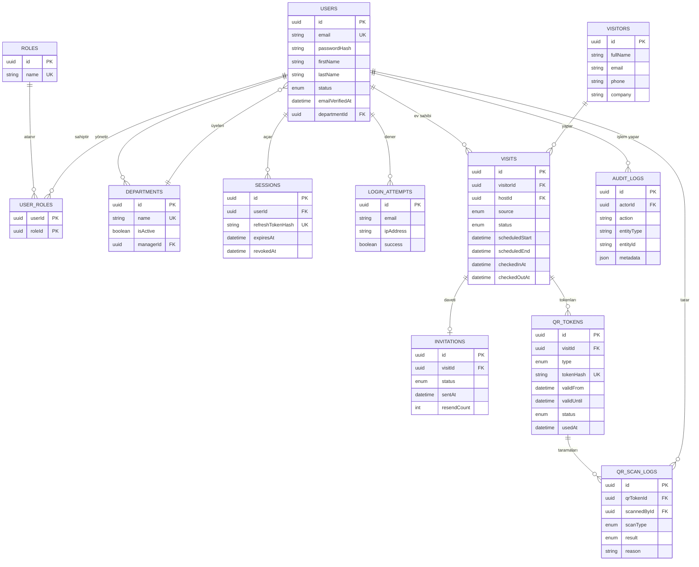
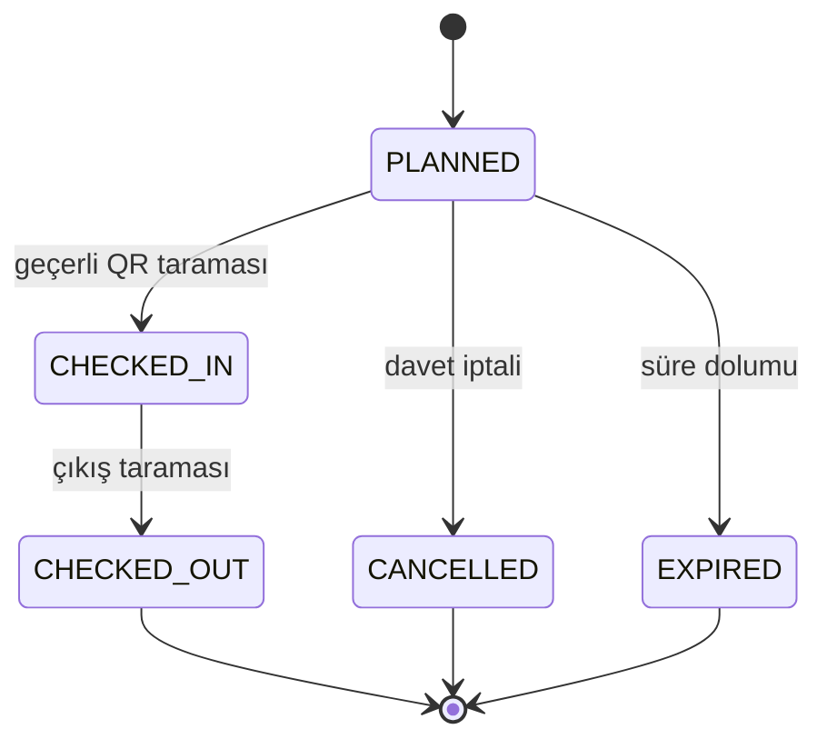

# Smart Office (AOS) – ER Diyagramı (P0 çekirdeği)

> Bu diyagram `backend/prisma/schema.prisma` ile birlikte güncel tutulur. Kargo, rezervasyon, acil durum ve KVKK talep tabloları ilgili haftalarda eklenecektir.

## Ziyaret durum makinesi

Geçersiz sıra (ör. girişsiz çıkış) ve tekrar işlemleri `REJECTED_INVALID_STATE` olarak reddedilir ve `qr_scan_logs` içine kaydedilir.
