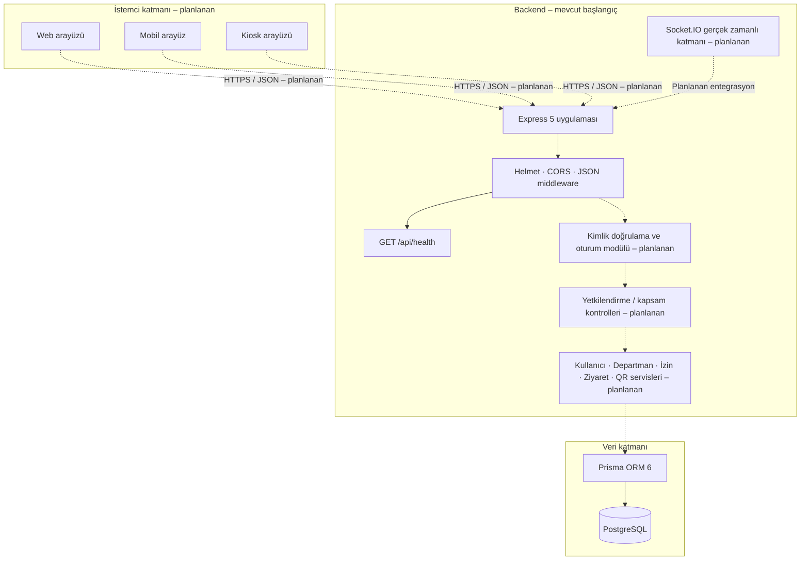
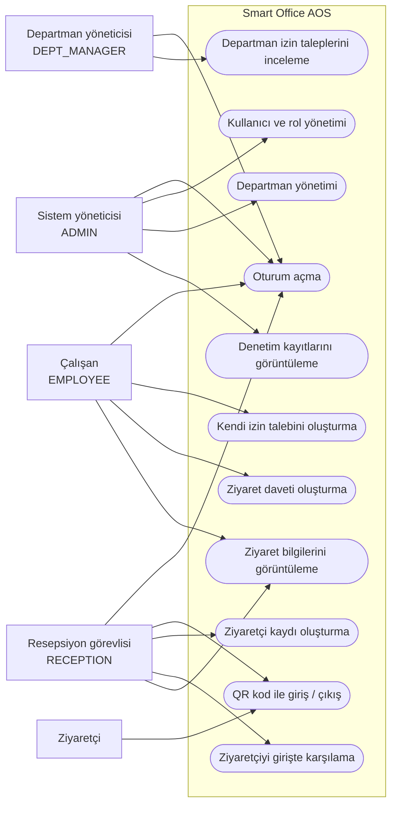
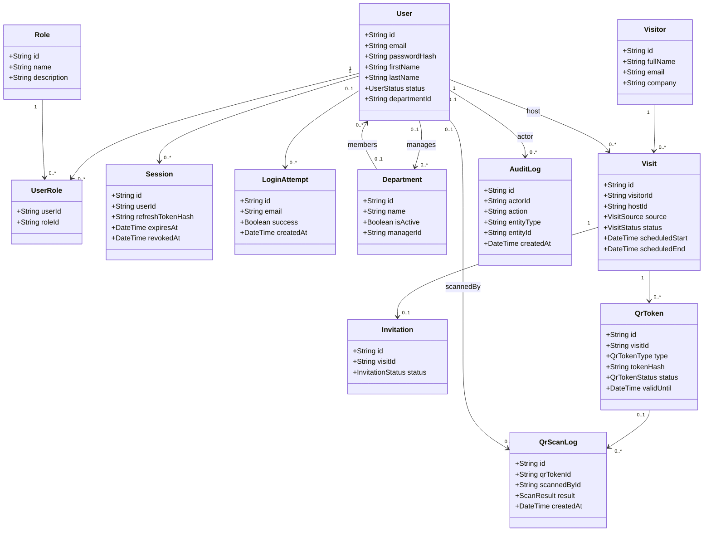
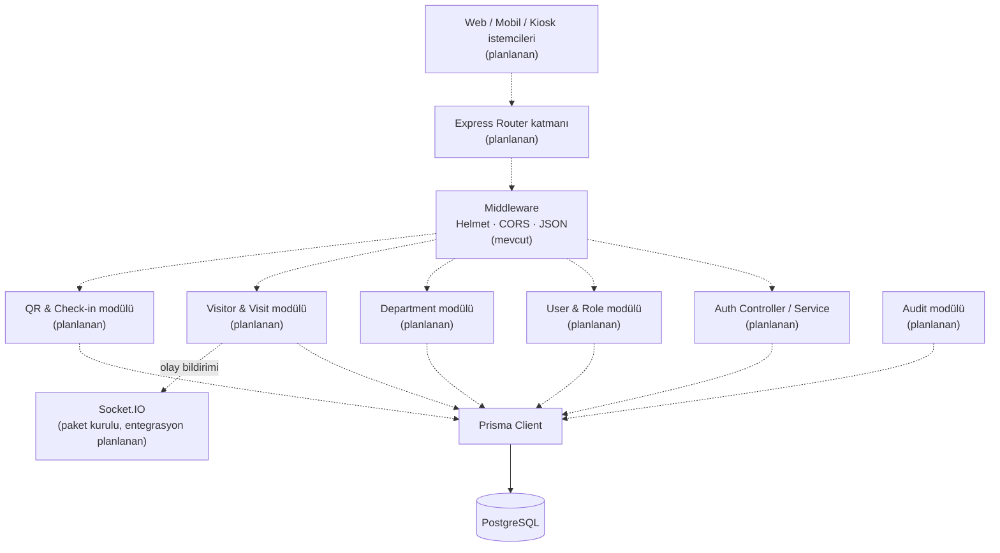
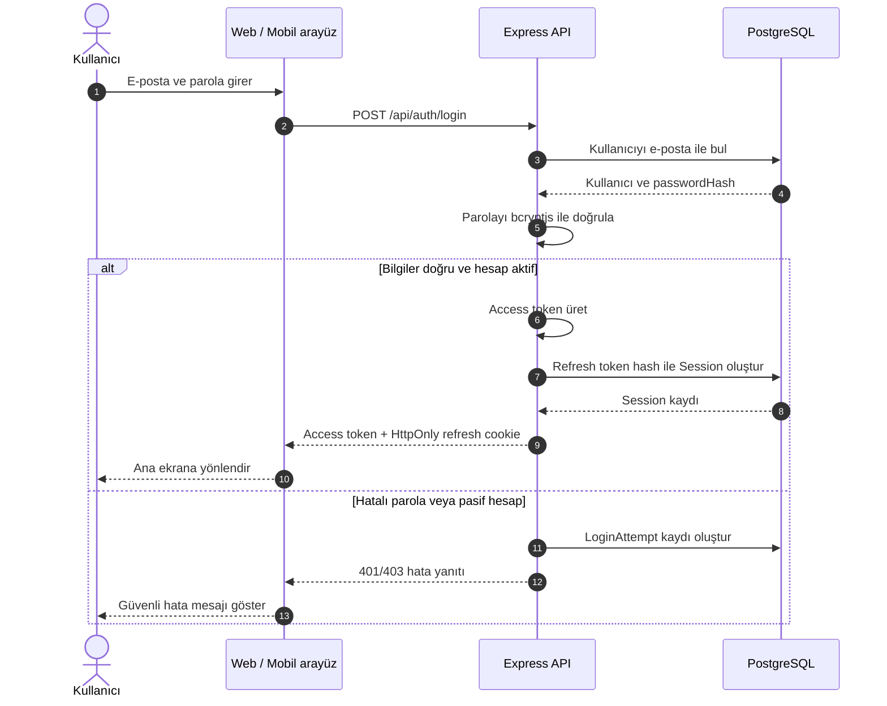
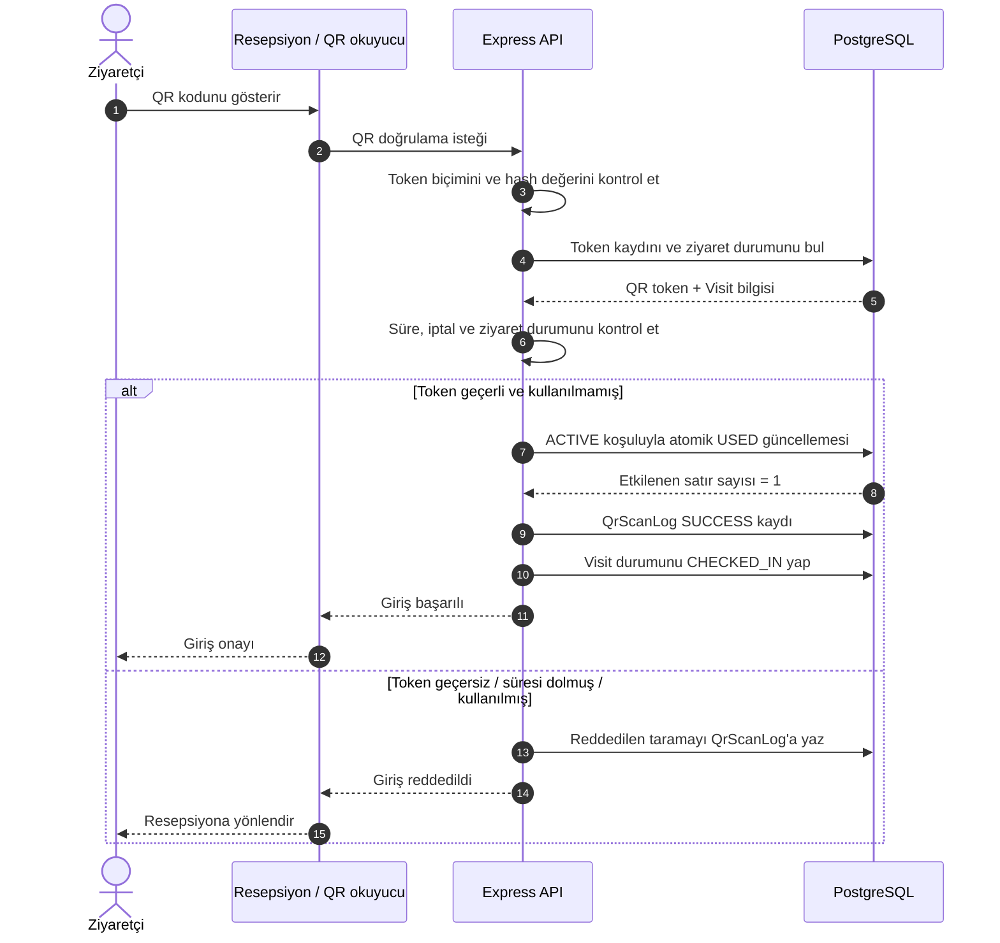
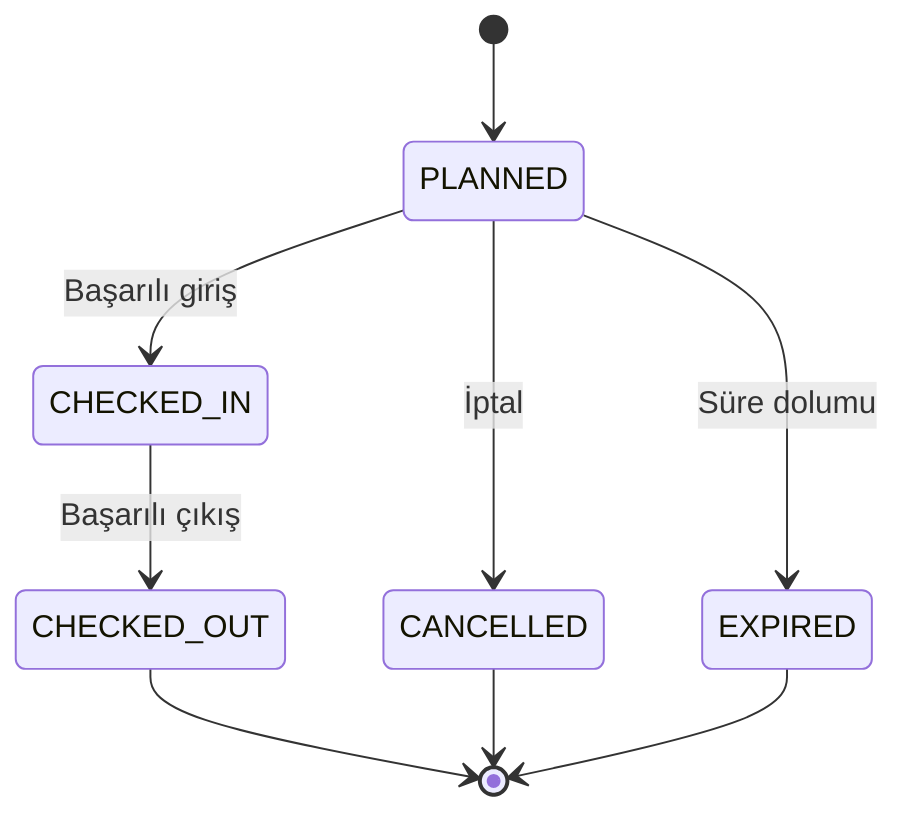

# Smart Office (AOS) – Sistem Mimarisi ve UML Diyagramları

**Belge türü:** Mimari taslak  
**Durum:** Tasarım dokümanı – mevcut kod ile planlanan bileşenler ayrıştırılmıştır  
**Teknoloji temeli:** Node.js, Express 5, Prisma 6, PostgreSQL  
**Son güncelleme:** 31.10.2026

> **Önemli:** Bu belge, mevcut GitHub deposunda incelenen `backend/src/index.js`, `backend/prisma/schema.prisma`, `backend/prisma/seed.js`, `backend/package.json` ve klasör yapısına dayanır. Prisma modellerinin bulunması ilgili API işlevlerinin tamamlandığı anlamına gelmez. Frontend klasörü şu an boştur. Diyagramlarda mevcut altyapı ile hedeflenen işlevler açıkça ayrılmıştır.

## 1. Mevcut sistemin teknik görünümü

| Katman | Mevcut durum |
|---|---|
| Backend çalışma zamanı | Node.js, CommonJS |
| HTTP uygulaması | Express 5 |
| Güvenlik başlıkları | Helmet |
| CORS | `cors` middleware'i etkin |
| İstek gövdesi | `express.json()` |
| Veritabanı | PostgreSQL |
| ORM | Prisma 6 |
| Kimlik doğrulama paketleri | `jsonwebtoken`, `bcryptjs` kurulu; akış henüz `index.js` içinde uygulanmamış |
| Gerçek zamanlı iletişim | `socket.io` kurulu; henüz uygulamaya bağlanmamış |
| Veri doğrulama | `zod` kurulu; henüz endpoint'lerde gösterilmemiş |
| Test | Jest ve Supertest kurulu |
| Frontend | `frontend/` klasörü boş; teknoloji ve ekranlar henüz uygulanmamış |
| Mevcut HTTP endpoint'i | `GET /api/health` |

### 1.1 Mevcut backend başlangıç akışı

`backend/src/index.js` şu anda Helmet, CORS ve JSON middleware'lerini etkinleştirir; `/api/health` endpoint'ini sunar ve `PORT` değişkeni yoksa 3000 portunda dinler.

### 1.2 Prisma veri modeli

Mevcut Prisma şemasında 12 model vardır:

- Kullanıcı ve yetki: `User`, `Role`, `UserRole`, `Session`, `LoginAttempt`
- Organizasyon: `Department`
- Ziyaretçi yönetimi: `Visitor`, `Visit`, `Invitation`
- QR: `QrToken`, `QrScanLog`
- Denetim: `AuditLog`

Şemadaki enum'lar: `UserStatus`, `VisitSource`, `VisitStatus`, `InvitationStatus`, `QrTokenType`, `QrTokenStatus`, `ScanResult`.

### 1.3 Seed ile oluşturulan roller

Seed dosyasındaki gerçek rol adları `ADMIN`, `RECEPTION`, `DEPT_MANAGER`, `EMPLOYEE` şeklindedir. Ziyaretçi, kullanıcı rolü olarak seed edilmez; ayrı `Visitor` modeliyle temsil edilir.

> **İsim standardı kararı:** Rol isimleri uygulama genelinde Prisma/seed ile aynı tutulmalıdır: `RECEPTION` ve `DEPT_MANAGER`. Önceki yetki matrisinde geçen `RECEPTIONIST` ve `DEPARTMENT_MANAGER` adları kodla eşleştirilmeden kullanılmamalıdır.

---

## 2. Sistem mimarisi

Aşağıdaki görünüm hedeflenen mantıksal mimariyi gösterir. Düz çizgili mevcut bileşenler depoda görülen altyapıyı; `Planlanan` olarak belirtilenler henüz uygulanmamış modülleri ifade eder.



## 3. Use Case Diagram – kullanıcı rolleri

Bu diyagram, hedeflenen işlevsel kapsamı gösterir; use case'lerin tamamı mevcut backend'de uygulanmış değildir.



**Yetki notları:** Bu işlevlerin kesin izinleri `docs/rol-yetki-matrisi.md` ile birlikte değerlendirilmelidir. Çalışan kendi izin talebini onaylayamaz. Departman yöneticisinin kendi talebi için ayrı onay kuralı belirlenmelidir. Ziyaretçinin normal sistem hesabı yoktur.

---

## 4. Class Diagram – Prisma veri modeli

Aşağıdaki sınıf diyagramı uygulama sınıflarından ziyade mevcut Prisma modellerini ve temel ilişkilerini temsil eder. Alanlar okunabilirlik için seçilmiştir; tam alan listesi `backend/prisma/schema.prisma` dosyasındadır.



### 4.1 İlişki açıklamaları

- `User` ile `Role` arasındaki çoktan çoğa ilişki `UserRole` ara modeliyle kurulur.
- Bir `Department` bir yöneticiye (`manager`) ve birden fazla üyeye sahip olabilir.
- Bir `Visitor` birden fazla `Visit` kaydına sahip olabilir.
- Her `Visit` bir çalışanı ev sahibi (`host`) olarak ve bir ziyaretçiyi referans alır.
- Bir ziyaretin en fazla bir `Invitation` kaydı vardır.
- Bir ziyaret için birden fazla `QrToken` üretilebilir.
- QR tarama denemeleri `QrScanLog` ile kaydedilir.
- `AuditLog` işlemi yapan kullanıcıyı ve etkilenen varlığı ilişkilendirir.

---

## 5. Component Diagram – yazılım bileşenleri

Bu diyagram hedeflenen modüler backend ayrımını gösterir. Mevcut kodda yalnızca Express başlangıç uygulaması ve health endpoint'i vardır; servis/controller/repository ayrımı henüz oluşturulmamıştır.



---

## 6. Sequence Diagram – oturum açma

Bu akış API sözleşmesindeki hedef davranışı gösterir. JWT ve bcryptjs paketleri kurulu olsa da giriş endpoint'i ve oturum yönetimi henüz `index.js` içinde uygulanmamıştır.



---

## 7. Sequence Diagram – QR ile ziyaretçi girişi

Bu akış hedeflenen QR ziyaretçi sürecidir. QR token güvenliğinin temel kuralı: veritabanında ham token değil, token özeti saklanır. Token tek kullanımlı olmalı ve durum güncellemesi atomik yapılmalıdır.



> **İşlem bütünlüğü:** QR token'ın tek kullanımlı olması için token durumunun `ACTIVE` koşuluyla atomik güncellenmesi gerekir. Güncellemeden etkilenen satır sayısı 1 değilse işlem reddedilmelidir. Visit durum değişikliği ve log kayıtları da uygun bir veritabanı transaction'ı içinde ele alınmalıdır.

---

## 8. Ziyaret durum makinesi

Prisma şemasındaki yorum ve enum değerlerine göre:



## 9. Güvenlik ve tasarım kuralları

1. Parolalar düz metin saklanmaz; `passwordHash` alanında güçlü parola özeti tutulur.
2. Refresh token'ın kendisi değil, özeti `Session.refreshTokenHash` alanında saklanır.
3. QR token'ın kendisi değil, SHA-256 özeti `QrToken.tokenHash` alanında saklanır.
4. QR token tek kullanımlı olmalı; tekrar kullanım atomik güncellemeyle engellenmelidir.
5. Yetkilendirme varsayılan olarak reddetmeli; rol kontrolü yanında kaynak sahipliği ve kapsam kontrolü de uygulanmalıdır.
6. Ziyaretçi kişisel verileri içerdiği için saklama süresi ve anonimleştirme politikası ayrıca tasarlanmalıdır.
7. Zaman alanları UTC saklanmalı; `Europe/Istanbul` dönüşümü yalnızca gösterim katmanında yapılmalıdır.
8. Manuel QR/giriş geçersiz kılma işlemleri gerekçe ve denetim kaydı içermelidir.

## 10. Uygulama öncesi netleştirilmesi gerekenler

- Yetki matrisi ile seed rol adları tek standarda getirilmeli.
- API sözleşmesindeki alan adları ve durum kodları gerçek Prisma alanlarıyla eşleştirilmeli.
- `Visit` oluşturma, iptal, check-in ve check-out işlemlerinin transaction sınırları tanımlanmalı.
- Kiosk kimlik doğrulama yöntemi ve kiosk sırrının saklanma yeri belirlenmeli.
- Frontend teknolojisi, web/mobil istemci ayrımı ve ortak API istemcisi kararlaştırılmalı.
- Socket.IO'nun hangi olaylarda kullanılacağı belirlenmeli; yalnızca paket kurulu olması gerçek zamanlı özelliğin hazır olduğu anlamına gelmez.
- KVKK kapsamındaki aydınlatma, veri saklama, silme/anonimleştirme ve erişim kayıtları tasarlanmalı.
- Prisma şeması ile API sözleşmesi arasında otomatik veya düzenli uyumluluk kontrolü kurulmalı.

## 11. Dosya yerleşimi önerisi

```text
docs/
├── api/
│   └── api-sozlesmesi.md
├── uml/
│   └── sistem-mimarisi-ve-uml.md
└── rol-yetki-matrisi.md
```

## 12. Belge durumu

Bu belge, tasarım ve analiz aşamasındaki mimari referanstır. Diyagramlar Mermaid destekleyen GitHub Markdown görüntüleyicisinde render edilebilir. Kod geliştikçe diyagramlar Prisma şeması, API endpoint'leri ve gerçek frontend yapısıyla birlikte güncellenmelidir.
